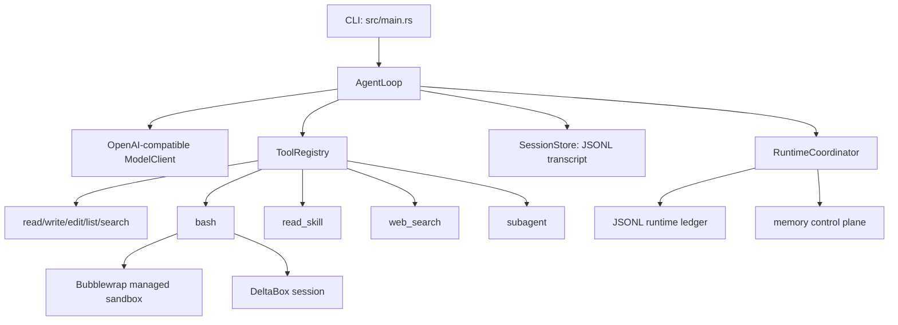

# pi-agent-rust

一个面向实际使用的 Rust Pi 风格智能体。它通过 OpenAI 兼容的 Chat Completions 接口连接本地或远程模型，由 `AgentLoop` 负责模型请求、工具调用、会话记录、取消和运行时状态管理。

这个项目同时服务于三个目标：学习智能体运行机制、学习 Rust 工程实践，以及为后续的智能体记忆系统提供可复用的平台。代码按运行时边界拆分，工具、模型、会话、技能、沙箱和记忆控制面可以独立测试和演进。

## 当前能力

- OpenAI 兼容接口和 SSE 流式响应。
- Qwen、MiMo、DeepSeek 等兼容服务；默认本地地址是 `http://127.0.0.1:6273/v1`，默认模型是 `qwen3.8`。
- 思考模式开关：默认开启，使用 `--no-think` 关闭，使用 `--think` 显式开启。
- AgentLoop 的模型 → 工具 → 模型循环，支持工具参数校验、工具选择、最大步数、重试、超时和取消。
- 工作区工具：
  - `read_file`：读取工作区内文件。
  - `write_file`：创建或覆盖文件，使用 Unix descriptor-relative 操作和原子重命名。
  - `edit_file`：按文本片段编辑文件。
  - `list_files`：受深度和数量限制的目录浏览。
  - `search_files`：受结果数、文件数和输出大小限制的文本搜索。
  - `bash`：执行 Bash 命令，默认通过 Bubblewrap 管理沙箱运行。
  - `web_search`：配置 `BRAVE_SEARCH_API_KEY` 后启用 Brave 搜索。
  - `read_skill`：使用 `--skills-dir` 时读取技能的完整指令。
  - `subagent`：在受限工具集合中运行一个子智能体。
- 并行执行标记为安全的只读工具；有副作用或不可重放的工具保持排他执行。
- JSONL 会话 transcript 和 JSONL runtime ledger，记录模型消息、工具结果、运行时准入和未知执行状态。
- 技能系统：扫描 `SKILL.md`，校验 frontmatter，向模型公开技能索引，只有模型明确调用 `read_skill` 时才加载完整正文。
- 三种 Bash 边界：
  - `managed`：默认的 Bubblewrap 隔离，使用独立挂载、用户、PID、网络命名空间，工作区映射为 `/workspace`。
  - `deltabox`：通过 DeltaBox-lite 提供带 diff、review、commit、abort 的持久事务工作区。
  - `disabled`：明确关闭沙箱，仅适用于受信任环境。
- runtime 控制面：动作准入、资源范围、运行时 revision、持久事件 ledger、取消和未知结果处理。
- workspace 还包含 provider-neutral 的 memory、runtime-adapter、benchmark 和 JitRL crate，便于后续接入记忆方法和评测流程。

## 架构



工具调用不是 CLI 直接执行的。模型返回工具调用后，`AgentLoop` 将其交给 `ToolRegistry`；工具结果写入会话，并回传给模型。运行时 ledger 记录动作准入和终态，因此超时、取消或进程异常时不会把“请求已发出”错误地当成“操作已成功”。

## 环境要求

- Rust stable toolchain 和 Cargo。
- Linux 上使用默认 `managed` 模式需要 Bubblewrap（`bwrap`）以及创建所需 namespace 的权限。
- 访问远程模型需要网络和对应 API key；本地模型通常不需要真实 key，但仍建议通过环境变量注入。
- `web_search` 需要 `BRAVE_SEARCH_API_KEY`。
- DeltaBox 模式需要已安装的 `deltabox`。Linux 命令隔离还需要可用的 Landlock；`cbcow-private` 额外需要 `/dev/fuse`。

检查工具链：

```bash
cargo --version
rustc --version
bwrap --version
```

## 快速开始

在项目目录执行：

```bash
cd /home/yanbt/pi0/membase1/agent-memory-lab/memagentbench/apps/pi-agent-rust

cargo run --offline -- \
  --base-url http://127.0.0.1:6273/v1 \
  --model qwen3.8 \
  --prompt "解释 Rust 中的 trait，并给出一个简短例子"
```

让模型实际使用 Bash 需要显式允许不可逆工具：

```bash
cargo run --offline -- \
  --allow-unsafe-shell \
  --workspace "$PWD/workspace" \
  --prompt "创建 hello.txt，然后读取它并说明内容"
```

默认启用思考模式。关闭思考模式：

```bash
cargo run --offline -- \
  --no-think \
  --prompt "只用一句话解释 KV Cache"
```

### MiMo 或 DeepSeek

不要把 key 写进命令行、配置文件或 Git。将 key 放在环境变量中，再通过 `--api-key-env` 指定变量名：

```bash
export MIMO_API_KEY='your-mimo-key'

cargo run --offline -- \
  --base-url https://api.xiaomimimo.com/v1 \
  --model mimo-v2.6-flash \
  --api-key-env MIMO_API_KEY \
  --prompt "请说明 Rust async/await 的基本执行模型"
```

DeepSeek 只需要替换 `--base-url`、`--model` 和环境变量名。具体 endpoint 以服务商文档为准。

### 使用配置文件

```toml
# config.toml
base_url = "http://127.0.0.1:6273/v1"
model = "qwen3.8"
api_key_env = "OPENAI_API_KEY"
workspace = "./workspace"
session_file = "./sessions/session.jsonl"
temperature = 0.7
enable_thinking = true
max_steps = 8
max_tool_calls_per_step = 16
max_parallel_tool_calls = 4
tool_timeout_secs = 120
max_context_messages = 128
max_context_bytes = 1048576
max_file_bytes = 1048576
max_tool_output_bytes = 65536
```

运行：

```bash
cargo run --offline -- \
  --config ./config.toml \
  --prompt "读取 workspace 中的 README 并总结"
```

显式命令行参数会覆盖配置文件中的对应值。没有传 `--config` 时，CLI 会使用本地模型友好的默认值：`http://127.0.0.1:6273/v1`、`qwen3.8` 和温度 `0.7`。

## 技能系统

技能目录中每个技能使用一个 `SKILL.md`：

```text
skills/
└── rust-review/
    └── SKILL.md
```

示例：

```markdown
---
name: rust-review
description: Review Rust code for correctness, ownership, and error handling.
---

Review the requested Rust code. Explain each finding and cite the relevant file.
```

加载技能：

```bash
cargo run --offline -- \
  --skills-dir ./skills \
  --prompt "使用 rust-review 技能检查 src/main.rs"
```

技能名只能使用小写字母、数字和单个连字符；重复名称、非法 frontmatter、过大的文件会产生诊断并被拒绝。`disable-model-invocation: true` 的技能不会出现在模型可见的技能索引中。

## 工具和安全边界

所有内置工具都受工作区路径、参数大小、输出大小和超时限制。`bash` 的工具风险等级是不可逆操作，CLI 默认要求 `--allow-unsafe-shell`，即使模型返回了 Bash 调用，也必须经过运行时准入。

`managed` 模式不会把宿主根目录挂载到沙箱根目录，而是创建临时根目录，仅暴露 Bash 所需的只读系统路径和 `/workspace`。网络 namespace 默认关闭，环境变量会被清理，能力会被丢弃。若 Bubblewrap 能力探测失败，程序会报错退出，不会静默退回宿主执行。

### DeltaBox

DeltaBox 成功运行后默认保留变更供 review；可以显式选择完成策略：

```bash
cargo run --offline -- \
  --sandbox-mode deltabox \
  --deltabox-bin /path/to/deltabox \
  --deltabox-fs-mode copy-private \
  --deltabox-on-success review \
  --prompt "修改 workspace 中的配置并说明 diff"
```

持久会话可以在没有模型请求的情况下查看或结束：

```bash
cargo run --offline -- \
  --deltabox-bin /path/to/deltabox \
  --deltabox-action status \
  --deltabox-session SESSION_ID

cargo run --offline -- \
  --deltabox-bin /path/to/deltabox \
  --deltabox-action diff \
  --deltabox-session SESSION_ID
```

`copy-private` 可以不使用 FUSE，但 Linux 命令隔离仍依赖 Landlock。若宿主内核返回 `ENOSYS`，程序会在模型请求前失败并给出内核配置诊断；不能把这种环境失败当成 DeltaBox 命令隔离已经通过。

## 会话和运行时记录

默认会话文件是 `./sessions/session.jsonl`。其中保存模型消息、工具调用和结构化工具结果。运行时 ledger 默认使用同一会话文件的 `.runtime.jsonl` 后缀，保存动作准入、成功、失败、取消和未知状态。

当外部工具的执行状态无法确认时，runtime 会记录 `unknown`，不会自动重放不可重放操作。可以使用 CLI 的 runtime reconcile 参数提供外部证据后完成收敛：

```bash
cargo run --offline -- \
  --session-file ./sessions/session.jsonl \
  --reconcile-action-id ACTION_UUID \
  --reconcile-evidence "检查外部系统确认没有写入"
```

## 测试和质量检查

```bash
cargo fmt --all -- --check
cargo check --offline --workspace --all-targets
cargo test --offline --workspace
cargo clippy --offline --workspace --all-targets -- -D warnings
git diff --check
```

真实模型测试应单独准备 endpoint 和 key。测试结果需要区分：代码单测、模拟模型/模拟 supervisor、真实模型调用和真实 OS 隔离；模拟 supervisor 不等于真实沙箱验收。

## 目录结构

```text
.
├── src/                  # CLI、AgentLoop、模型客户端、工具、技能、会话
├── runtime/              # 运行时准入、ledger、进程 gateway、沙箱、DeltaBox RPC
├── memory/               # provider-neutral 的记忆领域契约
├── memory-agent/         # 记忆检索、路由和投影控制面
├── memory-remote/        # 远程记忆 provider 适配
├── artifacts/            # 内容寻址 artifact 存储
├── runtime-adapter/      # AgentLoop、runtime 和 memory 的组合层
├── benchmark/            # benchmark 契约和轨迹
├── benchmark-runner/     # benchmark 执行
├── benchmark-evaluator/  # 离线评估和聚合
├── agent-benchmark-adapter/
├── jitrl/                # action-level 的历史轨迹调整
└── tests/                # 跨模块集成测试和测试 fixture
```

## 当前边界和后续方向

- DeltaBox 的事务控制、文件 diff、commit/abort 已接入；真实命令隔离取决于宿主 Landlock 和 FUSE 能力。
- runtime ledger、工具结果和 DeltaBox journal 目前是不同记录边界，尚未提供跨三者的原子提交协议。
- 记忆控制面已经有 provider-neutral 契约和 runtime 注入边界，后续继续接入真实 provider、WorkingSet、预测和检索并行化。
- benchmark crate 与主 CLI 保持边界，真实数据集和模型评测应使用对应 runner，而不是把评测逻辑塞进 AgentLoop。

## License

MIT
